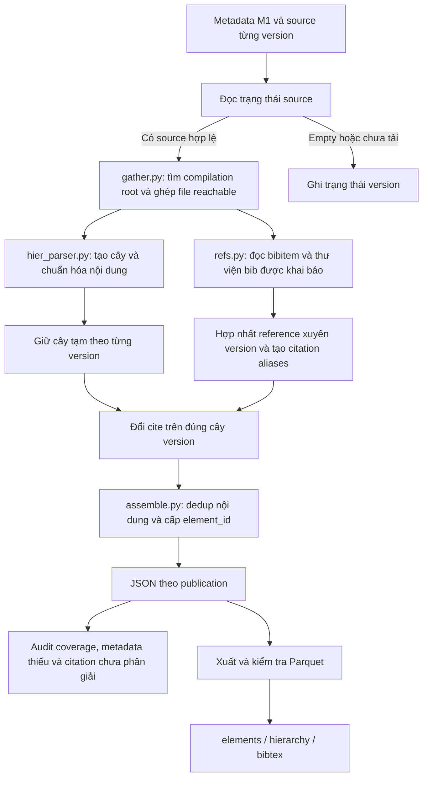
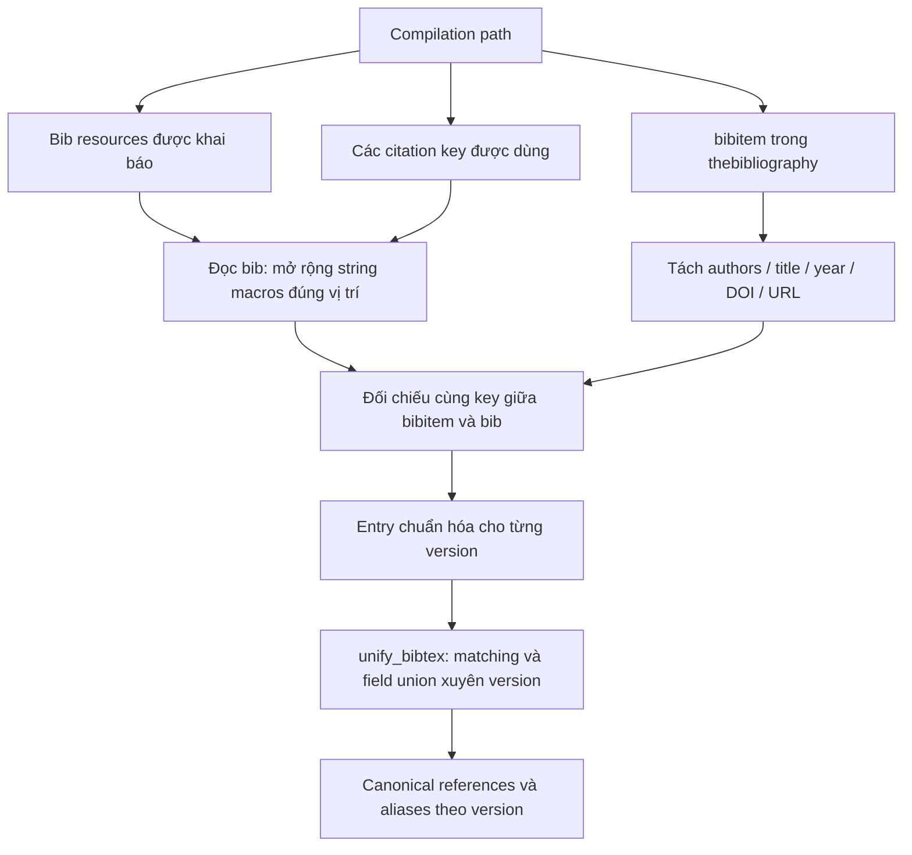

# Tutorial Milestone 2: parser LaTeX, BibTeX và kiểm chứng output

Cập nhật: **19/11/2026**. Tài liệu mô tả mã đã tích hợp vào [denver1106/hcmus-project-arxiv](https://github.com/denver1106/hcmus-project-arxiv), commit `27297b0`.

Mục tiêu: hiểu cách biến source LaTeX của Milestone 1 thành ba bảng `elements`, `hierarchy`, `bibtex`; biết chạy lại trên dữ liệu sẵn có, đọc số liệu và xử lý những phần chưa hoàn tất.

## 1. Hiện trạng cần nắm trước khi chạy

Phân biệt ba mức hoàn thành:

1. **Đã có chức năng:** gathering, hierarchy, cleanup/math normalization, reference extraction, field union, đổi citation key và xuất Parquet đã được triển khai.
2. **Đã kiểm chứng:** 126/126 test đạt ở lượt kiểm chứng, CI Python 3.11 và 3.13 thành công. Đã thử xử lý toàn bộ range 5.000 bài có trong workspace.
3. **Chưa hoàn tất toàn nhóm:** chưa có input ba range còn lại trong `Documents/IntroDS`; vẫn có references cần review. Không ghi rằng toàn bộ 20.000 bài đã hoàn tất.

| Thành viên | MSSV | Range, hai đầu đều được tính | Input tìm thấy trong lần kiểm chứng |
|---|---|---|---|
| Dương Huỳnh Minh Khôi | 24127192 | `2606.00734–2606.05733` | 5.000 bài |
| Đỗ Thành Vinh | 24127262 | `2605.02338–2605.07337` | Chưa có |
| Tạ Mai Như Ngọc | 24127465 | `2602.09870–2602.14869` | Chưa có |
| Trương Quang Tạo | 24127534 | `2512.18231–2512.23230` | Chưa có |

**Publication khác version:** một publication có một arXiv ID và có thể có nhiều version. Tổng 20.000 là số publication được giao, không phải số version.

## 2. Vị trí mã và dữ liệu trên máy hiện tại

```text
/Users/mac/Documents/IntroDS/
├── tutorial.md
├── hcmus-main-publish/              # Checkout dùng để tích hợp lên denver1106/main
│   ├── src/
│   ├── tests/
│   ├── reports/milestone2_validation.md
│   └── README.md
├── hcmus-m2-update/                 # Checkout branch kiểm chứng trước khi tích hợp
├── hcmus-project-arxiv/             # Checkout cũ, có thay đổi local riêng
├── .venv-m2-verified/               # Môi trường đã dùng để kiểm chứng
├── work/raw/                       # Input thực tế hiện có
│   └── 2606.00734/
│       ├── paper_metadata.json
│       └── sources/v1/
│           ├── manifest.json
│           ├── main.tex
│           ├── ...
│           └── sample.bib
└── output/
    ├── m2_verified_2606_clean/      # JSON + audit của lượt đầy đủ
    ├── m2_verified_2606_export/     # Parquet đã kiểm tra schema
    └── m2_group_verified/          # Tổng hợp theo bốn range
```

Các thư mục mang tên `sample100_v*` hoặc các lượt thử bị dừng là dữ liệu chẩn đoán trước đó. Khi đọc kết quả cuối của lần kiểm chứng này, dùng ba thư mục `m2_verified_2606_clean`, `m2_verified_2606_export` và `m2_group_verified`.

Để dùng đúng mã mới, các ví dụ dưới chạy từ `hcmus-main-publish`. Không tự reset/checkout đè `hcmus-project-arxiv` cũ vì ở đó có thay đổi chưa commit.

## 3. Flow tổng thể



**Thứ tự quan trọng:** hợp nhất references → đổi citation key trong cây → dedup full text.

Nếu v1 viết `\cite{k1}` và v2 viết `\cite{k2}` cho cùng reference, cần đổi chúng về một key trước. Nếu so sánh câu trước khi đổi key, hai câu giống nhau về nghĩa vẫn khác chuỗi và không được dùng chung element.

### Các module nên đọc theo thứ tự

| Module | Trách nhiệm |
|---|---|
| [pipeline.py](src/pipeline.py) | Điều phối một publication, mọi version, resume, trạng thái và ghi output |
| [gather.py](src/gather.py) | Root, include graph, compilation path và bib resources |
| [hier_parser.py](src/hier_parser.py) | Hierarchy, câu, list, formula, figure/table và cleanup |
| [refs.py](src/refs.py) | BibTeX/bibitem, field union và đổi citation key |
| [assemble.py](src/assemble.py) | Element store dùng chung xuyên version và quan hệ cha–con |
| [audit_m2.py](src/tools/audit_m2.py) | Chạy kiểm chứng cục bộ và tạo báo cáo chất lượng |
| [export_verified_m2.py](src/tools/export_verified_m2.py) | Xuất shard Parquet và kiểm tra kiểu dữ liệu/số dòng |

## 4. Đọc input và giữ coverage đúng

Pipeline hỗ trợ hai layout.

**Layout corpus chuẩn:**

```text
corpus/2606-00734/
├── paper.json
├── v1/
│   ├── metadata.json
│   └── main.tex
└── v2/
    └── metadata.json
```

**Layout hiện có trong workspace:**

```text
work/raw/2606.00734/
├── paper_metadata.json
└── sources/
    ├── v1/
    │   ├── manifest.json
    │   └── main.tex
    └── v2/
        └── manifest.json
```

`process_paper` đọc danh sách version trong metadata, sắp theo số version rồi xử lý từng version. Không chỉ duyệt các thư mục source đang có, vì như vậy sẽ bỏ mất version chưa download.

| Trạng thái M2 | Ý nghĩa |
|---|---|
| `parsed` | Gather, parser và extraction của version hoàn thành |
| `empty` | Source được ghi là empty/no_tex, hoặc gather không có TeX |
| `not_downloaded` | Thiếu marker, download thất bại hoặc trạng thái M1 chưa được nhận diện là hợp lệ |
| `no_root` | Có TeX nhưng không xác định được root theo quy tắc |
| `timeout` | Vượt thời hạn cho version |
| `parse_error` | Exception khi gather/parse/extract version |

Version `empty` được giữ trong record nhưng không sinh parsed elements. Không xóa nó khỏi coverage rồi công bố tỷ lệ thành công cao hơn.

**Lỗi cấp publication:** nếu lúc hợp nhất references phát hiện cùng key trong cùng version nhận diện các công trình không tương thích, publication được ghi vào `paper_failures.json` và không có JSON output hoàn chỉnh. Đây khác với record `empty`.

## 5. Parser: từ nhiều file LaTeX thành một cây

### 5.1. Multi-file gathering

`gather_version(version_dir)` thực hiện:

1. Đọc các file `.tex`, ưu tiên UTF-8 và có fallback Latin-1.
2. Bỏ comment để lệnh `\input` nằm trong comment không được thực thi.
3. Tìm ứng viên root chứa `\documentclass` hoặc `\documentstyle`; khi có nhiều ứng viên, dùng heuristic chọn root.
4. Theo `\input`, `\include` và các dạng include được hỗ trợ, ghép nội dung đúng vị trí.
5. Ghi file reachable trong `included`, file không reachable trong `unreachable`.
6. Ghi include bị thiếu hoặc vòng lặp vào thông tin chẩn đoán.
7. Tìm thư viện `.bib` được khai báo bằng `\bibliography`/`\addbibresource`.

Ví dụ:

```text
main.tex ──input──> sections/intro.tex
         └include─> sections/method.tex

old_draft.tex      # Không reachable → không đưa vào nội dung
unused_refs.bib    # Không được khai báo → không đọc làm references
```

Có file trong thư mục không có nghĩa là file đó được dùng khi biên dịch. Đây là lý do không nối tất cả `.tex` hoặc đọc tất cả `.bib` một cách vô điều kiện.

### 5.2. Heading stack

Parser dùng thứ tự:

```text
part → chapter → section → subsection → subsubsection → paragraph → subparagraph
```

Khi gặp heading mới, parser pop các heading có cấp bằng hoặc sâu hơn rồi gắn heading mới vào ancestor còn lại. Tài liệu không có chapter vẫn tạo được section dưới document hoặc part.

```latex
\part*{Main matter}
\section{Introduction}
\subsection*{Motivation}
\paragraph{Our setting}
\section*{Acknowledgements}
\appendix
\section*{Proof details}
```

Dạng có dấu `*` vẫn được nhận diện thành heading. Node hiện tại không có trường `numbered` riêng, nên không suy luận rằng output lưu đầy đủ thông tin đánh số của LaTeX.

`\appendix` tạo nhánh Appendix; các acknowledgements environment phổ biến cũng được giữ lại. References trong `thebibliography` và các lệnh bibliography không được đưa vào hierarchy văn bản.

### 5.3. Các loại node

```text
document
└── heading: Method
    ├── sentence: We define the model.
    ├── list: itemize
    │   ├── item
    │   │   └── sentence: First condition.
    │   └── item
    │       ├── sentence: Second condition.
    │       └── list: enumerate
    │           └── item
    │               └── sentence: Nested condition.
    ├── formula: \begin{equation} ... \end{equation}
    └── figure: Table: Comparison of methods
```

- `itemize`/`enumerate` là node `list`, mỗi `\item` là node `item`.
- Figure và table cùng được đưa về loại `figure`. Nội dung chủ yếu là phần text/caption đã trích xuất, không phải ảnh nhị phân hay một bản dựng lại PDF.
- Block math là lá `formula`.
- `\(...\)` là **inline math**: chuẩn hóa sang `$...$` và nằm trong sentence; không tự tạo node block formula.
- Lá văn xuôi là sentence. Parser bảo vệ math, URL, số thập phân và một danh sách viết tắt khi tách câu.

### 5.4. Cleanup và chuẩn hóa

Các ví dụ về hướng chuẩn hóa:

| Trước | Sau hoặc cách xử lý |
|---|---|
| `\textbf{Important result}` | Giữ text `Important result` |
| `\centering`, placement của figure, `\midrule` | Loại lệnh trình bày không mang nghĩa cần giữ |
| `\(x + 1\)` | `$x + 1$` |
| `$$x=1$$` hoặc `\[x=1\]` | `\begin{equation} x=1 \end{equation}` |
| Nội dung chỉ khác khoảng trắng | Gộp khoảng trắng khi tạo identity |
| Unicode có nhiều cách biểu diễn | Chuẩn hóa NFC trong bước canonicalization |

Parser là chương trình xử lý source bằng heuristic, không chạy TeX engine. Custom macros, conditional compilation và environment lạ vẫn cần kiểm tra trên mẫu.

## 6. BibTeX: tách reference khỏi hierarchy

### 6.1. Hai nguồn reference

`extract_references(gathered, version_dir, bib_scope="cited")` lấy:

- Các `\bibitem` trong `thebibliography` thuộc compilation path đã gather.
- Các entry trong những file `.bib` mà tài liệu thực sự khai báo.



### 6.2. Parse file .bib

```bibtex
@string{j = "Journal of Examples"}
@article{doe2020,
  author = {Doe, Jane and Roe, John},
  title = {Reliable Parsing},
  year = {2020},
  journal = j,
  doi = {10.1000/example}
}
```

Output có dạng:

```json
{
  "citation_key": "doe2020",
  "entry_type": "article",
  "title": "Reliable Parsing",
  "authors": ["Jane Doe", "John Roe"],
  "year": 2020,
  "doi": "10.1000/example",
  "journal": "Journal of Examples",
  "url": ""
}
```

Macro `j` được mở rộng khi là token của giá trị journal. Từ `j` nằm trong title literal không được thay bằng tên journal.

Bản sửa cũng xử lý quote có escape, một số dấu TeX trong tên như `Sch{\"{u}}tz` → `Schütz`, và tránh quét lại toàn bộ phần đuôi file cho từng entry bị hỏng.

### 6.3. Parse bibitem

```latex
\bibitem{k}
Jane Doe and John Roe.
\newblock Reliable Parsing.
\newblock Journal of Examples, 2020.
```

Ranh giới được nhận diện theo ưu tiên và kiểm tra ngữ cảnh:

1. Các trường `\bibinfo{author}`/`\bibinfo{title}` nếu có.
2. Separator `\newblock`, đồng thời phân biệt separator trước title với separator chỉ xuất hiện trước venue.
3. Quote hoặc định dạng title.
4. Heuristic author–title theo dấu câu, có xử lý kiểu author-year.

Các ca đã được sửa và thêm regression test:

- `A. Vaswani`: không coi dấu chấm của initial là kết thúc author list.
- `Jane Doe (2020). A useful title.`: không cắt mất title sau năm.
- Journal nằm trong `\emph{...}`: không gộp journal vào title.
- Quote LaTeX và quote thường trộn kiểu.
- Apostrophe trong họ tên.
- Dấu TeX, khoảng trắng sau `et al.` và năm nằm trong title.

Khi không đủ căn cứ tách, có thể để trống title/authors. `entry_type` của bibitem hiện là `misc`, `journal` chưa được trích xuất tổng quát. Entry chuẩn hóa không có nghĩa là một citation free-form đã được nhận diện hoàn hảo.

### 6.4. Chế độ cited và all

| Chế độ | Cách lấy entries từ .bib |
|---|---|
| `cited`, mặc định | Chỉ parse các key được cite; `\nocite{*}` khiến giữ toàn bộ |
| `all` | Giữ mọi entry trong thư viện đã khai báo |

Các bibitem trong bibliography vẫn được giữ dù không tìm thấy cite tương ứng trong body.

Thư viện dùng chung thực tế có file 38–44 MB. Chế độ `cited` được tối ưu để chọn key cần dùng trước khi parse fields, thay vì parse hàng chục nghìn entries rồi mới bỏ phần không được dùng.

`audit_m2.py` hiện dùng cố định `cited`. Muốn chọn `all`, dùng CLI `pipeline.py --bib-scope all`; nó có thể tốn thời gian và RAM hơn đáng kể.

### 6.5. Cùng key xuất hiện ở bibitem và .bib

Khi có cùng key trong bản render bibitem và trong thư viện .bib đã khai báo:

- Ưu tiên metadata có cấu trúc trong .bib.
- Điền field còn thiếu bằng thông tin từ bản render.
- Lưu bất đồng trong `extraction_conflicts`.

Không áp dụng quy tắc này để tự gộp tùy ý hai công trình dùng trùng key trong cùng một nguồn.

## 7. Dedup references và field union

### 7.1. Nhận diện cùng reference

Các bước dùng index để tìm ứng viên:

1. DOI đã chuẩn hóa.
2. Title đã chuẩn hóa.
3. Citation key khi các bằng chứng còn lại tương thích.

Các ràng buộc quan trọng:

- Hai DOI đều có và khác nhau: không gộp.
- Cùng DOI: được coi là bằng chứng mạnh; title/year khác nhau được giữ như xung đột metadata.
- Không có DOI đủ để kết luận: title, year và authors không được mâu thuẫn theo quy tắc matching.
- Không chỉ vì hai entry dùng cùng citation key mà luôn coi chúng là một công trình.

Đây là matching bằng quy tắc; chưa phải mô hình semantic matching của Milestone 3.

### 7.2. Field union thực hiện thế nào?

| Field | Quy tắc chính |
|---|---|
| `authors` | Hợp nhất tên bổ sung; mở rộng initial nếu tên tương thích |
| Field đang thiếu | Điền từ entry trùng có dữ liệu |
| `title` tương đương sau chuẩn hóa | Có thể giữ cách biểu diễn dài hơn |
| Scalar có hai giá trị khác nhau | Giữ giá trị theo chính sách ưu tiên và lưu alternatives trong `field_conflicts` |
| `source_keys` | Giữ cặp version/key nguồn phục vụ truy vết |

Ví dụ minh họa:

```json
{
  "citation_key": "k1",
  "authors": ["Alice Smith", "Bob Jones", "Carol Lee"],
  "year": 2020,
  "doi": "10.1000/example",
  "field_conflicts": {
    "journal": ["Preprint", "Journal of Examples"]
  },
  "source_keys": [
    {"version": 1, "citation_key": "k1"},
    {"version": 2, "citation_key": "k2"}
  ]
}
```

Authors là danh sách hợp nhất theo các bằng chứng tên tương thích; không coi đó là xác nhận độc lập về thứ tự tác giả của bản xuất bản cuối.

### 7.3. Citation aliases phải theo từng version

```python
unified_entries, aliases = unify_bibtex(per_version, versioned=True)

for version, tree in trees.items():
    mapping = aliases.get(version, {})
    for node in iter_nodes(tree):
        node.content = rename_cites(node.content, mapping)
```

Nếu key `k` của v1 và key `k` của v2 lại chỉ hai công trình khác nhau, pipeline cấp key riêng cho reference cần phân biệt và chỉ đổi cite trên đúng cây version.

Ngược lại, nếu **trong cùng một version** một key chỉ tới hai reference không tương thích, alias không đủ để biết người viết đang cite công trình nào. Pipeline báo lỗi và quarantine publication, không chọn ngẫu nhiên một reference.

API mặc định trả flat map chỉ phù hợp khi không có key reuse mơ hồ. Pipeline dùng `versioned=True`.

## 8. Dedup full text và ba bảng output

`PaperAssembler` dùng identity:

```text
(kind, nội dung sau cleanup + NFC + gộp khoảng trắng, occurrence index)
```

Occurrence index giúp hai câu giống nhau lặp hai lần trong cùng version vẫn là hai node khác nhau. Nếu bỏ nó, một node có thể bị gắn hai parent và cây bị sai.

Ví dụ cùng một câu xuất hiện ở v1 và v2:

```text
elements:
  paper#root1    document  Version 1 root
  paper#root2    document  Version 2 root
  paper#h1       heading   Introduction
  paper#h2       heading   Background
  paper#s1       sentence  We study the model.

hierarchy:
  v1  paper#h1 -> paper#root1
  v1  paper#s1 -> paper#h1
  v2  paper#h2 -> paper#root2
  v2  paper#s1 -> paper#h2
```

`#s1` chỉ có một row trong elements nhưng được dùng ở hai version với parent khác nhau.

| Bảng | Nội dung và kiểu quan trọng |
|---|---|
| `elements` | `element_id`, `arxiv_id` non-null string; `kind` dictionary; `content` string |
| `hierarchy` | `arxiv_id`, `element_id`, `parent_id` non-null string; `version` int32 |
| `bibtex` | `arxiv_id`, `citation_key` non-null string; `entry_type` dictionary; `title` string; `authors` list<string>; `year` nullable int32; `doi`, `journal`, `url` string |

Root có trong elements nhưng không có edge tới parent. JSON theo publication giữ thêm trạng thái version, aliases và metadata chẩn đoán; Parquet chỉ xuất các columns theo schema. Vì vậy phải giữ JSON để review conflict sau khi export.

## 9. Chuẩn bị môi trường và chạy test

Các khối lệnh dưới là hướng dẫn chạy lại; không tự thực thi khi mở file tutorial.

### 9.1. Dùng môi trường đã tạo trên máy này

```bash
export INTRODS_ROOT="/Users/mac/Documents/IntroDS"
export M2_REPO="$INTRODS_ROOT/hcmus-main-publish"

cd "$M2_REPO"
source "$INTRODS_ROOT/.venv-m2-verified/bin/activate"

python --version
git rev-parse HEAD
python -m unittest discover -s tests -v
```

Lượt kiểm chứng đã đạt 126/126 test. CI tương ứng: [run trên denver1106/main](https://github.com/denver1106/hcmus-project-arxiv/actions/runs/44485487363).

### 9.2. Nếu cần một môi trường mới

Tạo tên riêng, không ghi đè môi trường đang dùng:

```bash
python3 -m venv "$INTRODS_ROOT/.venv-m2-tutorial"
source "$INTRODS_ROOT/.venv-m2-tutorial/bin/activate"
python -m pip install pandas pyarrow psutil
```

Ba package trên đủ cho phần parser/audit/export và các test hiện tại. Nếu dùng cả crawler M1 hoặc tái lập toàn bộ môi trường repo, cài `src/requirements.txt`.

Các ví dụ audit phù hợp macOS/Linux/Colab; `audit_m2.py` dùng module `resource` của POSIX. Trên Windows nên dùng WSL hoặc Colab. Timeout của pipeline dựa trên SIGALRM và không có hiệu lực tương đương trên Windows native.

## 10. Chạy từ nhỏ đến lớn

### 10.1. Mẫu 100 bài

Dùng thư mục output mới:

```bash
python src/tools/audit_m2.py \
  --corpus-dir "$INTRODS_ROOT/work/raw" \
  --output-dir "$INTRODS_ROOT/output/m2_tutorial_sample100_v1" \
  --sample 100 \
  --workers 2 \
  --timeout 30
```

`--sample` chọn các publication cách đều trong danh sách đã sắp xếp; không phải random sample. Nên bổ sung các case khó như multi-file, nhiều version, bibliography lớn và macro tùy biến khi đánh giá accuracy.

`timeout` là giới hạn mỗi version. Một publication nhiều version có thể chạy lâu hơn giới hạn đó.

Lượt audit trả exit code 1 nếu có publication failed, **nhưng vẫn ghi output của các publication thành công và summary**. Đọc `paper_failures.json` trước khi kết luận toàn bộ lượt chạy thất bại.

### 10.2. Toàn bộ input hiện có

```bash
python src/tools/audit_m2.py \
  --corpus-dir "$INTRODS_ROOT/work/raw" \
  --output-dir "$INTRODS_ROOT/output/m2_tutorial_full_v1" \
  --workers 4 \
  --timeout 30
```

Không có `--sample` nghĩa là xử lý tất cả publication có metadata trong input được chỉ định, không có nghĩa là tự tìm hoặc tải đủ 20.000 bài.

Chọn workers theo máy và RAM thực tế. Bốn workers là cấu hình đã dùng cho lượt local hiện tại, không phải cấu hình tối ưu được chứng minh cho mọi máy. Trên Colab CPU có thể bắt đầu với hai workers.

### 10.3. Dùng CLI pipeline trực tiếp

CLI này có thêm `--only`, `--limit`, `--bib-scope`, `--force` và các lựa chọn merge:

```bash
python src/pipeline.py \
  --corpus-dir "$INTRODS_ROOT/work/raw" \
  --out-dir "$INTRODS_ROOT/output/m2_tutorial_pipeline_v1/parsed" \
  --work-dir "$INTRODS_ROOT/output/m2_tutorial_pipeline_v1/work" \
  --workers 2 \
  --timeout 30 \
  --bib-scope cited \
  --limit 10
```

`--limit 10` lấy 10 bài đầu, khác với mẫu cách đều của audit.

| Option | Ý nghĩa |
|---|---|
| `--only 2606.00734` | Chọn đúng tên folder ở layout raw hiện tại |
| `--no-merge` | Parse JSON, chưa dựng logs/tables |
| `--merge-only` | Dựng lại logs/tables từ JSON đã có, không parse source |
| `--force` | Reparse paper có JSON sẵn |
| `--shard-size` | Số publication mỗi shard; không phải số row |

Tên file JSON phụ thuộc publication folder: layout raw hiện tại tạo dạng `2606.00734.json`; corpus dùng folder gạch ngang tạo dạng `2606-00734.json`.

### 10.4. Resume, fingerprint và tránh output cũ

`audit_m2.py` lưu hash của năm module xử lý trong `source_fingerprint.json`. Nếu mã đổi mà dùng lại thư mục có hash cũ, nó từ chối chạy để tránh trộn kết quả.

Tuy nhiên fingerprint không thay thế toàn bộ quản lý thí nghiệm:

- Đổi input, sample, timeout hoặc cấu hình đáng kể: dùng output mới.
- JSON paper đã tồn tại có thể được skipped ở lần chạy lại. Tăng timeout không có nghĩa là các JSON lỗi version cũ tự được tính lại.
- CLI `pipeline.py` resume theo file JSON; sau sửa parser cần output mới hoặc `--force`.
- Không coi thời gian một lượt resume là benchmark fresh.
- Không gom các lượt sample, full hoặc các lần chạy trùng publication thành một tổng.

## 11. Đọc và kiểm tra output

### 11.1. Files do audit sinh ra

| File/thư mục | Cách dùng |
|---|---|
| `parsed/*.json` | Elements, edges, references, version records và provenance theo publication |
| `summary.json` | Tổng trạng thái, counts trước/sau dedup, quality flags và range coverage |
| `source_fingerprint.json` | Phiên bản mã, Python và platform |
| `paper_failures.json` | Publication chưa có output hoàn chỉnh và nguyên nhân |
| `coverage.csv` | Một dòng cho từng version nằm trong output đã tạo |
| `publications.csv` | Counts/status/dedup theo publication có output |
| `unresolved_citations.csv` | Citation key không có trong tập reference hợp nhất |
| `reference_review.jsonl` | Reference thiếu metadata hoặc có conflicts cần review |

`coverage.csv` không tự có các version thuộc publication đã fail toàn bộ. Đối chiếu thêm `paper_failures.json` và metadata đầu vào để tính coverage trên tất cả version được khai báo.

### 11.2. Xem summary đã có mà không parse lại

```bash
python -m json.tool "$INTRODS_ROOT/output/m2_verified_2606_clean/summary.json"
python -m json.tool "$INTRODS_ROOT/output/m2_verified_2606_clean/paper_failures.json"
```

### 11.3. Xem một publication và các reference cần review

```python
import json
from pathlib import Path

base = Path("/Users/mac/Documents/IntroDS/output/m2_verified_2606_clean")

paper = json.loads((base / "parsed" / "2606.00734.json").read_text(encoding="utf-8"))
print("Versions:", [(v["version"], v["status"]) for v in paper["versions"]])
print("Stats:", paper["stats"])
print("Citation aliases:", paper.get("citation_aliases", {}))

for entry in paper["bibtex"][:3]:
    print(entry["citation_key"], entry.get("title"), entry.get("authors"))

with (base / "reference_review.jsonl").open(encoding="utf-8") as handle:
    for index, line in enumerate(handle):
        print(json.loads(line))
        if index == 2:
            break
```

JSONL là một JSON object trên mỗi dòng; không đọc cả file bằng một lần `json.load` như file JSON thông thường.

### 11.4. Diễn giải quality flags

- Thiếu DOI không tự động là lỗi parser: source có thể không cung cấp DOI.
- Thiếu title/authors có thể do source thiếu hoặc heuristic chưa nhận diện được; cần mở source đối chiếu.
- `field_conflicts` là bất đồng giữa reference được match, còn `extraction_conflicts` là bất đồng khi đối chiếu bản render với .bib cùng key.
- `unresolved_citation_occurrences` trong summary thực tế đếm các bộ **(publication, version, key)** chưa phân giải. Một key lặp nhiều lần trong cùng version chỉ được tính một lần.
- Quarantine không được đổi thành parsed bằng cách xóa lỗi hoặc tự điền reference.

## 12. Xuất Parquet và xác minh schema

Để xuất lại từ JSON đã parse, không cần chạy parser lần nữa:

```bash
python src/tools/export_verified_m2.py \
  --parsed-dir "$INTRODS_ROOT/output/m2_verified_2606_clean/parsed" \
  --output-dir "$INTRODS_ROOT/output/m2_tutorial_export_v1" \
  --shard-size 250
```

`export_verified_m2.py` yêu cầu destination mới hoặc rỗng. Nếu báo lỗi `Use a fresh export directory`, chọn tên khác để tránh giữ shard thừa của lượt trước.

```text
m2_tutorial_export_v1/
├── export_validation.json
├── logs/
│   ├── parse_papers.csv
│   └── parse_versions.csv
└── tables/
    ├── elements/elements-00000.parquet
    ├── hierarchy/hierarchy-00000.parquet
    └── bibtex/bibtex-00000.parquet
```

Công cụ đối chiếu số dòng Parquet với JSON, kiểm tra ID non-null/string, dictionary encoding, `authors` dạng list<string>, `year`/`version` int32 và từ chối JSON đã có hierarchy problems.

Đọc một bảng theo batch để tránh nạp toàn bộ vào RAM:

```python
from pathlib import Path
import pyarrow.dataset as ds

table_dir = Path("/Users/mac/Documents/IntroDS/output/m2_verified_2606_export/tables/bibtex")
dataset = ds.dataset(table_dir, format="parquet")

print(dataset.schema)
print("Rows:", dataset.count_rows())

for batch in dataset.to_batches(
    columns=["arxiv_id", "citation_key", "title", "authors"],
    batch_size=5,
):
    print(batch.to_pydict())
    break
```

Schema và counts đúng chưa chứng minh title/authors đúng về ngữ nghĩa. Phần đó cần bộ mẫu có đáp án và review source.

## 13. Tổng hợp đủ bốn range

Mỗi thành viên cần tạo output riêng bằng cùng phiên bản parser. Sau khi có đủ bốn bộ:

```bash
python src/tools/audit_m2.py \
  --aggregate-parsed \
    "$INTRODS_ROOT/output/range_2606/parsed" \
    "$INTRODS_ROOT/output/range_2605/parsed" \
    "$INTRODS_ROOT/output/range_2602/parsed" \
    "$INTRODS_ROOT/output/range_2512/parsed" \
  --output-dir "$INTRODS_ROOT/output/m2_tutorial_group_v1"
```

Các đường dẫn ở ví dụ này là tên dự kiến, **chưa tồn tại đủ trên máy hiện tại**. Mỗi parent của `parsed/` cần có `source_fingerprint.json`.

Công cụ từ chối:

- Cùng một publication xuất hiện trong hai input.
- Output có fingerprint parser khác nhau.
- Thiếu fingerprint sidecar.

Nó không parse lại source và không biến ba range đang thiếu thành dữ liệu đã xử lý. `processed` trong range coverage là số publication có JSON output, không nhất thiết là số publication có mọi version đã hoàn tất.

Tổng hợp audit chưa tạo một bộ Parquet nhóm mới. Cần tổ chức một tập JSON publication không trùng và xuất lại vào destination mới, hoặc quản lý các shard range như những partition rõ ràng. Không chép đè các shard cùng tên `bibtex-00000.parquet` của bốn range vào cùng thư mục.

## 14. Kết quả thực tế của lượt đã thực hiện

Input `work/raw` hiện có 5.000 publication và 6.785 version được khai báo.

| Metric | Kết quả |
|---|---:|
| Publication đã thử xử lý | 5.000 |
| Publication có output | 4.982 |
| Publication có mọi version parsed hoặc empty | 4.932 |
| Publication quarantine vì reference xung đột | 18 |
| Version parsed | 6.392 |
| Version empty | 310 |
| Version not_downloaded | 56 |
| Version no_root | 2 |
| Version thuộc các publication quarantine | 25 |
| Timeout / parse exception ở các version có output | 0 / 0 |
| Hierarchy problems được phát hiện | 0 |

`6.392 + 310 + 56 + 2 + 25 = 6.785`. Vì vậy không bỏ mất các version chỉ vì chưa có output hoàn chỉnh.

| Mốc dedup / output | Số lượng |
|---|---:|
| Nodes trước dedup, không roots | 3.086.577 |
| Elements sau dedup, không roots | 2.381.064 |
| Rows bảng elements, có 6.392 roots | 2.387.456 |
| Rows bảng hierarchy | 3.086.577 |
| Reference entries đưa vào unify_bibtex | 255.551 |
| References sau hợp nhất / rows bibtex | 191.103 |

Mốc 255.551 là sau bước lọc citation và đối chiếu bibitem với .bib cùng key; không phải mọi entry thô trong tất cả thư viện được tải về.

Các việc còn phải review:

| Cờ | Số lượng |
|---|---:|
| Reference thiếu title | 6.262 |
| Reference thiếu authors | 6.728 |
| Reference thiếu year | 4.965 |
| Reference có field_conflicts | 2.352 |
| Reference có extraction_conflicts | 62 |
| Bộ (publication, version, key) cite chưa phân giải | 21.400 |

Lượt parse local dùng bốn workers, khoảng **528,896 giây**, peak RAM process tree khoảng **519,375 MiB**. JSON khoảng **628.385.585 bytes**, Parquet **151.939.648 bytes**.

Đây là số đo local macOS/Python 3.13, không phải benchmark Colab CPU. Wall time và RAM của lượt audit đo giai đoạn parse; chưa cộng thời gian audit/export sau đó. Lấy mẫu RSS mỗi giây có thể bỏ lỡ peak và có thể đếm lặp bộ nhớ chia sẻ.

Báo cáo đầy đủ: [milestone2_validation.md](reports/milestone2_validation.md).

## 15. Xử lý lỗi theo đúng flow

| Dấu hiệu | Kiểm tra trước | Hướng xử lý |
|---|---|---|
| Publication failed do key xung đột | `paper_failures.json` và các entry cùng key trong source | Xác định cùng công trình hay hai công trình; ghi quyết định review; không gộp tự động khi chưa có căn cứ |
| `not_downloaded` | Metadata, manifest hoặc metadata marker | Bổ sung source M1 thật còn thiếu, rồi dùng output mới/reparse |
| `no_root` | Có `\documentclass`/`\documentstyle` không? Root có bị comment hoặc thiếu file không? | Nếu là plain TeX, giữ trạng thái và ghi ngoại lệ; không giả định file đầu tiên là root |
| Missing includes | `missing_includes` và compilation path | Kiểm tra file thiếu, đường dẫn, encoding hoặc macro includes |
| Cite chưa phân giải | `unresolved_citations.csv` và bib declarations | Kiểm tra key, source bib/bbl thiếu và custom macro |
| Title bị lẫn venue | Source bibitem và `reference_review.jsonl` | Thêm case regression từ source, sửa boundary, chạy test rồi reparse có kiểm soát |
| `Code changed` | `source_fingerprint.json` | Dùng output directory mới |
| Output mới vẫn giống bản cũ | Paper bị skipped do JSON đã có? | Dùng output mới hoặc `pipeline.py --force` |
| RAM scope là `main_process_only` | Quyền enumerate child process | Không công bố đó là tổng RAM workers; đo lại trong môi trường đủ quyền |
| Export báo destination không rỗng | Có shard cũ không? | Dùng destination mới, không trộn shard cũ/mới |

### Quy trình sửa một lỗi parser/BibTeX

1. Chọn một publication/version bị lỗi và giữ source gốc.
2. Rút thành một fixture nhỏ nhất vẫn tái hiện lỗi.
3. Viết test với title/authors/cấu trúc mong đợi đã được đối chiếu.
4. Sửa module liên quan, chạy test mới rồi toàn bộ bộ test.
5. Chạy lại một mẫu đa dạng trong output mới.
6. Kiểm tra coverage, conflicts, unresolved citations và nội dung thực tế; không chỉ nhìn exit code.
7. Reparse phần dữ liệu cần thiết, lưu fingerprint và xuất bảng mới.
8. Cập nhật báo cáo: phạm vi input, mẫu số coverage, số liệu trước/sau và hạn chế còn lại.

## 16. Checklist trước khi kết luận hoàn thành Milestone 2

- [ ] Có input và output thực của đủ bốn range, không trùng publication.
- [ ] Mọi version được khai báo đều có kết quả hoặc nguyên nhân thiếu được báo.
- [ ] Các publication quarantine đã được review hoặc được nêu rõ là chưa hoàn tất.
- [ ] Đã review một mẫu có đáp án về hierarchy, title/authors và citation mappings.
- [ ] Đã đo coverage và dedup bằng đúng mẫu số; không dùng field completeness làm accuracy.
- [ ] Ba bảng đúng schema, counts và IDs; JSON/provenance vẫn được giữ.
- [ ] Có benchmark end-to-end trên Colab CPU: thời gian, RAM, dung lượng output và cấu hình.
- [ ] Báo cáo Jupyter Book được cập nhật bằng các số đo đã xác nhận.

**Kết luận hiện tại:** chức năng parser/BibTeX đã được triển khai, sửa và kiểm chứng; output của range đang có đã được tạo và audit. Dữ liệu BibTeX/M2 toàn nhóm 20.000 bài vẫn chưa thể đánh dấu hoàn tất.

